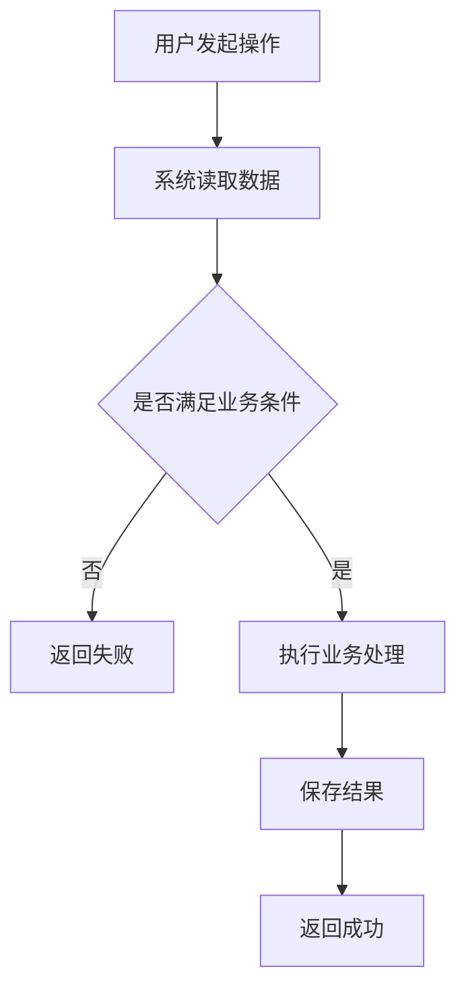
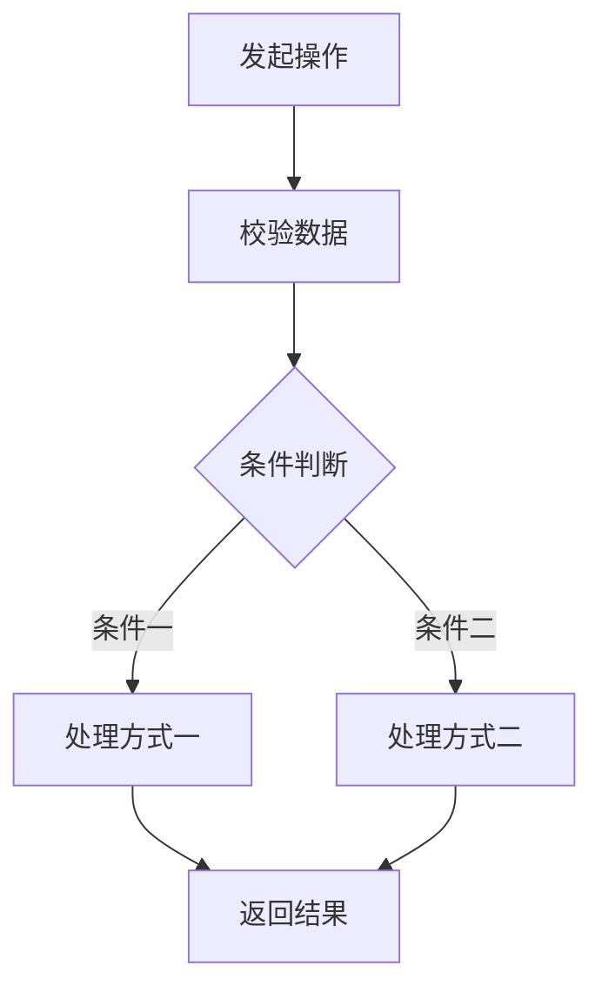
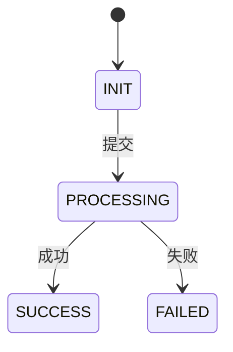

# 需求分析

> 生成规则：发现关键规则缺失、描述冲突、术语含义不清或异常处理不确定时，先向需求方澄清。最终文档只保留已确认结论。
> 下列业务名称、场景、状态及链接均为结构示例，不代表实际需求；生成时按已确认材料替换，不适用的示例删除。

## 编写约定

1. 术语、范围、规则、场景、流程分支、异常边界、验收结果和状态变化均须标注出处。短条目在句末写 `（出处：[材料名称](来源路径)，章节/页码/记录时间及条目）`；表格使用“出处”列。
2. 本地材料优先使用相对链接：用户输入指向 `../原始需求/原始需求.md` 的具体时间记录，附件指向 `../原始需求/输入文件/` 下的对应文件并注明章节或页码，外部材料使用原链接及定位信息。不能只写“用户要求”“参考原始需求”等无法定位的描述。
3. 同一连续段落或流程图完全共用出处时，可在其前统一标注并说明覆盖范围；混合来源逐项标注。归纳结论列出支撑它的来源；现有代码仅能证明现有行为，未经确认不能作为期望规则的依据。出处缺失或冲突先澄清，不编造来源。
4. 规则、范围、流程说明、异常边界等短段落使用 `1. 2. 3.` 有序列表，每项表达一个可独立理解的结论；对照数据保留表格。列表序号随段落排列，场景编号保持稳定。

---

## 1. 业务术语

集中定义本需求中的业务名称，后文统一使用标准名称。同名多义时明确限定词，别名明确对应标准名称；沿用项目已确认定义，不根据日常含义自行推定。

| 标准名称 | 业务含义 | 适用范围及易混淆概念 | 别名（无则填“无”） | 出处 |
|---|---|---|---|---|
| 活动（示例） | 填写本需求中活动所指的业务对象 | 说明活动的范围及与其他活动类型的区别 | XXX | [材料名称](<来源路径>)，具体位置 |
| 订单（示例） | 填写订单代表的业务事实 | 说明与交易、支付单等概念的关系与区别 | XXX | [材料名称](<来源路径>)，具体位置 |
| 客户（示例） | 填写客户的业务身份 | 说明与用户、账号、联系人等概念的区别 | XXX | [材料名称](<来源路径>)，具体位置 |

---

## 2. 需求理解

### 2.1 需求目标

1. 目标：说明要解决的问题。（出处：[材料名称](<来源路径>)，具体位置）
2. 使用对象：XXX。（出处：[材料名称](<来源路径>)，具体位置）
3. 最终结果：XXX。（出处：[材料名称](<来源路径>)，具体位置）

### 2.2 功能范围

本次包含：

1. XXX。（出处：[材料名称](<来源路径>)，具体位置）
2. XXX。（出处：[材料名称](<来源路径>)，具体位置）

本次不包含：

1. XXX。（出处：[材料名称](<来源路径>)，具体位置）
2. XXX。（出处：[材料名称](<来源路径>)，具体位置）

### 2.3 核心规则

只记录会影响业务流程的主要规则。

1. XXX 必须满足 XXX。（出处：[材料名称](<来源路径>)，具体位置）
2. XXX 状态下允许 XXX。（出处：[材料名称](<来源路径>)，具体位置）
3. XXX 状态下禁止 XXX。（出处：[材料名称](<来源路径>)，具体位置）
4. XXX 发生变化时，按 XXX 处理。（出处：[材料名称](<来源路径>)，具体位置）
5. 重复操作按 XXX 处理。（出处：[材料名称](<来源路径>)，具体位置）

---

## 3. 场景划分

1. 按用户实际业务行为划分，不按接口或页面划分。
2. 每个需要独立设计和验收的场景分配唯一编号，如 `S-001`、`S-002`。需要独立实现的子场景也单独编号；普通处理分支归入所属场景。
3. 编号在本需求文档内唯一，场景树、场景列表、场景分析与详细设计使用相同编号和名称。
4. 新增场景使用未使用的新编号；调整顺序或名称时保留原编号，已删除场景的编号不复用。

场景树中的场景出处见下方同编号列表；处理分支的出处见对应场景分析条目。

```text
功能名称
├── S-001 场景一
│   ├── 处理分支 A
│   └── 处理分支 B
└── S-002 场景二
    ├── 处理分支 A
    └── 处理分支 B
```

| 场景编号 | 场景 | 说明 | 出处 |
|---|---|---|---|
| S-001 | 场景一 | XXX | [材料名称](<来源路径>)，具体位置 |
| S-002 | 场景二 | XXX | [材料名称](<来源路径>)，具体位置 |

---

## 4. 主要流程

仅对核心业务流程画流程图。图中判断、分支及结果的出处对应下方流程说明；不同节点来源不同时逐项注明。



### 流程说明

1. 用户执行 XXX 操作，系统读取 XXX 数据。（出处：[材料名称](<来源路径>)，具体位置）
2. 满足 XXX 条件后执行 XXX。（出处：[材料名称](<来源路径>)，具体位置）
3. 如果 XXX 不满足，则 XXX。（出处：[材料名称](<来源路径>)，具体位置）
4. 最终保存 XXX 并返回 XXX。（出处：[材料名称](<来源路径>)，具体位置）

---

## 5. 场景分析

场景列表中的每个编号均需在本章展开，按实际场景数量增减。

### 5.1 S-001 场景一

#### 场景说明

1. 触发条件与目标：说明用户在什么情况下执行操作，以及最终需要达到什么结果。（出处：[材料名称](<来源路径>)，具体位置）

#### 处理流程

简单流程直接使用下方处理步骤；存在明显分支时再使用流程图，节点出处对应处理步骤与异常边界条目。



#### 处理步骤

1. 校验 XXX；满足 XXX 时进入后续处理。（出处：[材料名称](<来源路径>)，具体位置）
2. 条件一成立时执行 XXX。（出处：[材料名称](<来源路径>)，具体位置）
3. 条件二成立时执行 XXX。（出处：[材料名称](<来源路径>)，具体位置）
4. 保存 XXX 并返回 XXX。（出处：[材料名称](<来源路径>)，具体位置）

#### 异常与边界

1. 数据不存在：XXX。（出处：[材料名称](<来源路径>)，具体位置）
2. 状态不允许：XXX。（出处：[材料名称](<来源路径>)，具体位置）
3. 参数为空：XXX。（出处：[材料名称](<来源路径>)，具体位置）
4. 参数非法：XXX。（出处：[材料名称](<来源路径>)，具体位置）
5. 数量达到边界：XXX。（出处：[材料名称](<来源路径>)，具体位置）
6. 重复操作：XXX。（出处：[材料名称](<来源路径>)，具体位置）
7. 并发操作：XXX。（出处：[材料名称](<来源路径>)，具体位置）
8. 处理失败：XXX。（出处：[材料名称](<来源路径>)，具体位置）

#### 验收标准

1. 描述可观察、可验证的业务结果，出处指向支撑该结果的已确认材料。
2. 异常与边界中已经明确的预期结果不重复填写，同样纳入验收范围。

| 前置条件 | 操作 | 预期结果 | 出处 |
|---|---|---|---|
| XXX | XXX | XXX | [材料名称](<来源路径>)，具体位置 |

---

### 5.2 S-002 场景二

#### 场景说明

1. 触发条件与目标：XXX。（出处：[材料名称](<来源路径>)，具体位置）

#### 处理步骤

1. XXX。（出处：[材料名称](<来源路径>)，具体位置）
2. XXX。（出处：[材料名称](<来源路径>)，具体位置）
3. XXX。（出处：[材料名称](<来源路径>)，具体位置）

#### 异常与边界

1. XXX：按 XXX 处理。（出处：[材料名称](<来源路径>)，具体位置）
2. XXX：按 XXX 处理。（出处：[材料名称](<来源路径>)，具体位置）
3. XXX：按 XXX 处理。（出处：[材料名称](<来源路径>)，具体位置）

#### 验收标准

1. 描述可观察、可验证的业务结果，出处指向支撑该结果的已确认材料。
2. 异常与边界中已经明确的预期结果不重复填写，同样纳入验收范围。

| 前置条件 | 操作 | 预期结果 | 出处 |
|---|---|---|---|
| XXX | XXX | XXX | [材料名称](<来源路径>)，具体位置 |

---

## 6. 状态变化

仅当需求存在明确业务状态时保留本章节。图中状态及变化的出处见下方对应表格；状态名称沿用项目已确认定义。



| 当前状态 | 操作 | 结果状态 | 是否允许 | 出处 |
|---|---|---|---|---|
| 初始创建 | XXX | INIT | 是 | [材料名称](<来源路径>)，具体位置 |
| INIT | XXX | PROCESSING | 是 | [材料名称](<来源路径>)，具体位置 |
| PROCESSING | XXX | SUCCESS | 是 | [材料名称](<来源路径>)，具体位置 |
| PROCESSING | XXX | FAILED | 是 | [材料名称](<来源路径>)，具体位置 |
| SUCCESS | XXX | - | 否 | [材料名称](<来源路径>)，具体位置 |
